# MÔ TẢ CHỨC NĂNG VÀ LUỒNG HOẠT ĐỘNG HỆ THỐNG QUẢN LÝ CỬA HÀNG MẮT KÍNH

> **Dự án:** EyeGlasses Shop Management System (Mắt Kính Thuận Thiên)  
> **Kiến trúc:** Node.js (Express) + MongoDB | React (Vite) + React Query + Tailwind CSS  
> **Tài liệu API:** `/api-docs` (Swagger UI)

---

## I. TỔNG QUAN HỆ THỐNG

Hệ thống Quản lý Cửa hàng Mắt Kính là một giải pháp web thương mại & POS quản lý toàn diện dành cho cửa hàng bán buôn/bán lẻ mắt kính, gọng kính và phụ kiện. Hệ thống hỗ trợ tối ưu hóa quy trình từ khâu nhập kho, in tem nhãn QR code, bán hàng xuất kho, quản lý khách hàng, nhân viên đến theo dõi và thu hồi công nợ.

---

## II. PHÂN QUYỀN VÀ VAI TRÒ NGƯỜI DÙNG

Hệ thống được thiết kế với 2 vai trò người dùng chính:

| Vai trò | Phân quyền & Phạm vi truy cập |
| :--- | :--- |
| **ADMIN (Quản trị viên)** | **Toàn quyền quản trị hệ thống:** • Xem Dashboard báo cáo doanh thu, tồn kho, công nợ. • Quản lý Sản phẩm, Biến thể (SKU), Giá bán & Tồn kho. • Quản lý Phiếu nhập kho (Import Goods). • Quản lý Hóa đơn / Phiếu xuất kho & Bán hàng. • Quản lý Công nợ khách hàng (Debts) & Nhật ký thu nợ. • Quản lý Danh mục Khách hàng & Nhân viên. • Cấu hình thông tin Công ty / Cửa hàng (In trên hóa đơn). • Thiết kế & In tem nhãn mã QR dán lên sản phẩm. |
| **STAFF (Nhân viên bán hàng / Thu ngân)** | **Quyền thao tác nghiệp vụ:** • Tạo và quản lý Hóa đơn / Phiếu xuất kho. • Quản lý & Tạo phiếu nhập kho. • Tra cứu danh sách & Thêm mới Khách hàng. • Tra cứu danh mục Sản phẩm & Số lượng tồn kho. *(Không truy cập các báo cáo doanh số nhạy cảm của Admin hay quản trị nhân sự/công ty)* |

---

## III. CHI TIẾT CÁC PHÂN HỆ VÀ CHỨC NĂNG

### 1. Xác thực & Phân quyền (Authentication)
* **Đăng nhập (Login):** Đăng nhập bằng `username` và `password`. Mật khẩu được mã hóa an toàn bằng `bcryptjs`.
* **Quản lý Phiên làm việc:** Xác thực qua Token / Cookie với cơ chế Refresh Token tự động.
* **Điều hướng theo Vai trò:** Người dùng tự động được chuyển hướng về trang làm việc tương ứng (`/admin` hoặc `/staff`).

### 2. Quản lý Sản phẩm & Biến thể (Product & Variant Management)
* **Quản lý Sản phẩm (Product):**
  * Lưu trữ Tên sản phẩm, Thương hiệu (Brand), Xuất xứ (Origin Country), Mô tả chi tiết, Danh sách hình ảnh.
  * Tự động sinh `slug` cho từng sản phẩm.
* **Quản lý Biến thể (Variant / SKU):**
  * Mỗi sản phẩm có thể có nhiều biến thể với Mã hàng (SKU) riêng biệt.
  * Thông tin chi tiết: Mã màu (Color Code), Đơn vị tính (`Cây`, `Cái`, `Hộp`), Giá bán, Số lượng tồn kho (`inventory`).
  * Tự động tạo và quản lý mã QR Code duy nhất cho từng SKU.
* **In tem nhãn QR (Label Printing / Sample Labels):**
  * Tùy chọn in tem mã QR chuyên dụng dán lên gọng kính / hộp kính.
  * Cho phép chọn nhiều SKU, điều chỉnh khổ tem in và xem trước (Preview) mẫu tem trước khi in ra máy in tem nhãn.

### 3. Quản lý Nhập kho (Import Goods)
* **Tạo phiếu nhập kho:**
  * Chọn các biến thể SKU cần nhập.
  * Nhập số lượng và giá vốn (Import Price) của từng mặt hàng.
  * Ghi nhận tên Nhà cung cấp (Supplier) và ghi chú nhập hàng.
* **Cập nhật tồn kho tự động:** Ngay khi lưu phiếu nhập, số lượng tồn kho của biến thể tương ứng được cộng tự động.
* **Xem lịch sử & Hủy phiếu nhập:** Hỗ trợ xem lại danh sách phiếu nhập kho và hủy phiếu nhập trong trường hợp kiểm hàng có sai sót.

### 4. Quản lý Hóa đơn & Bán hàng (POS / Invoices)
* **Lập Hóa đơn / Phiếu xuất kho:**
  * Quét mã QR code hoặc tìm kiếm nhanh sản phẩm theo SKU / Tên sản phẩm.
  * Tự động tính tiền, hỗ trợ áp dụng chiết khấu (%) trên từng dòng sản phẩm.
  * Chọn khách hàng có sẵn hoặc tạo nhanh khách hàng mới trực tiếp trên màn hình bán hàng.
  * Gắn tên Nhân viên bán hàng chịu trách nhiệm đơn hàng.
* **Tính năng Bản nháp (Draft Invoice):**
  * Cho phép lưu hóa đơn dưới dạng bản nháp (`isDraft: true`).
  * Bản nháp không trừ tồn kho, không sinh mã phiếu chính thức và không tính vào công nợ cho đến khi được chốt thanh toán.
* **Phương thức thanh toán:**
  * Tiền mặt (`CASH`)
  * Chuyển khoản (`TRANSFER`)
  * Ghi nợ (`DEBT`) – Tự động đẩy hóa đơn sang Phân hệ Quản lý Công nợ.
  * Miễn phí / Hàng mẫu (`NONE` / `isSample`).
* **Trừ tồn kho & In hóa đơn:**
  * Hóa đơn chính thức tự động trừ tồn kho của từng SKU tương ứng.
  * Lưu trữ Snapshot thông tin Công ty, Khách hàng, Sản phẩm tại thời điểm bán để bảo đảm tính chính xác lịch sử.
  * Hỗ trợ in hóa đơn xuất kho chuyên nghiệp kèm mã QR đơn hàng.

### 5. Quản lý Công nợ (Debt Management)
* **Tự động khởi tạo công nợ:** Hóa đơn thanh toán theo hình thức Ghi nợ (`DEBT`) sẽ tự động tạo hồ sơ công nợ mới.
* **Theo dõi nợ khách hàng:**
  * Theo dõi Tổng nợ gốc, Tổng tiền đã thanh toán, và Số tiền còn nợ (`remainingAmount`).
  * Trạng thái công nợ: Chưa trả (`UNPAID`), Trả một phần (`PARTIAL`), Đã hoàn tất (`COMPLETED`), Đã hủy (`CANCELLED`).
* **Nhật ký thu nợ (Payment History):**
  * Ghi nhận mỗi lần khách hàng ghé thanh toán bớt nợ: Số tiền nộp, Ngày nộp, Ghi chú, Nhân viên thu tiền.
  * Tự động tính toán lại số nợ còn lại và cập nhật trạng thái khi nợ đã được thanh toán hết (`remainingAmount = 0`).

### 6. Quản lý Khách hàng (Customer Management)
* Quản lý danh sách thông tin khách hàng: Mã KH, Họ tên, Số điện thoại, Mã số thuế, Địa chỉ, Email.
* Tra cứu lịch sử mua hàng và tổng công nợ tích lũy theo từng khách hàng.

### 7. Quản lý Nhân viên (Staff Management)
* Thêm mới và quản lý hồ sơ nhân viên: Mã NV, Họ tên, Số điện thoại, Địa chỉ, Email.
* Phân bổ nhân viên phụ trách giao dịch bán hàng và nhập kho để theo dõi doanh số & hiệu suất công việc.

### 8. Cấu hình Thông tin Công ty / Cửa hàng (Company Info)
* Quản lý thông tin thương hiệu cửa hàng: Tên công ty/cửa hàng, Địa chỉ, Số điện thoại, Mã số thuế, Logo, Thông tin tài khoản ngân hàng.
* Thông tin này tự động được chèn vào tiêu đề mọi hóa đơn in ra cho khách hàng.

### 9. Báo cáo & Thống kê (Dashboard & Analytics)
* **Dành riêng cho ADMIN:**
  * Thống kê tổng doanh thu, số lượng đơn hàng theo ngày/tháng.
  * Thống kê số lượng sản phẩm bán ra, danh sách mặt hàng bán chạy.
  * Theo dõi tổng giá trị tồn kho và tổng tiền công nợ chưa thu hồi.

---

## IV. CÁC LUỒNG HOẠT ĐỘNG CHÍNH (WORKFLOWS)

```mermaid
flowchart TD
    subgraph Import ["1. Luồng Nhập Kho"]
        A1[Tạo Phiếu Nhập Kho] --> A2[Chọn SKU + Số lượng + Giá vốn]
        A2 --> A3[Xác nhận Nhập kho]
        A3 --> A4[Cộng Tồn kho Variant + Lưu ImportReceipt]
    end

    subgraph POS ["2. Luồng Bán Hàng & Xuất Kho"]
        B1[Mở Màn hình Bán hàng] --> B2[Quét mã QR / Chọn SKU]
        B2 --> B3[Nhập CK% + Chọn Khách hàng & Nhân viên]
        B3 --> B4{Lựa chọn}
        B4 -- Lưu Nháp --> B5[Lưu Draft Invoice - Không trừ kho]
        B4 -- Chốt Đơn --> B6{Phương thức Thanh toán}
        B6 -- Tiền mặt / Chuyển khoản --> B7[Trừ Tồn kho Variant + In Hóa đơn]
        B6 -- Ghi Nợ DEBT --> B8[Trừ Tồn kho Variant + Sinh Hồ sơ Công nợ + In Hóa đơn]
    end

    subgraph Debt ["3. Luồng Thu Hồi Công Nợ"]
        C1[Khách hàng đến trả nợ] --> C2[Tìm hồ sơ nợ theo Tên/SĐT]
        C2 --> C3[Nhập số tiền thu + Lưu Nhật ký thu nợ]
        C3 --> C4[Trừ remainingAmount]
        C4 --> C5{Remaining = 0?}
        C5 -- Có --> C6[Chuyển trạng thái COMPLETED]
        C5 -- Không --> C7[Giữ trạng thái PARTIAL]
    end
```

---

### 1. Luồng Nhập Kho (Goods Import Workflow)
1. **Người dùng** vào màn hình **Nhập hàng (Import Goods)**.
2. Tìm kiếm và chọn danh sách biến thể (SKU) cần nhập.
3. Nhập **Số lượng nhập** và **Giá vốn** cho từng dòng sản phẩm.
4. Nhập thông tin Nhà cung cấp và Ghi chú (nếu có).
5. Bấm **Xác nhận Nhập kho**:
   - Hệ thống tạo phiếu nhập kho `ImportReceipt`.
   - Tự động cộng số lượng tồn kho `inventory` của từng SKU trong hệ thống.

---

### 2. Luồng In Tem Nhãn Sản Phẩm (Label Printing Workflow)
1. **Admin** truy cập màn hình **In tem nhãn (Sample Labels)**.
2. Lựa chọn danh sách các mặt hàng / SKU cần in tem.
3. Tùy chỉnh thông số khổ giấy, nội dung hiển thị trên tem (Mã QR, Tên SP, SKU, Giá bán).
4. Xem trước giao diện tem và thực hiện **In tem** để dán lên gọng kính/hộp kính.

---

### 3. Luồng Bán Hàng & Xuất Kho (POS Sales Workflow)
1. **Thu ngân / Nhân viên** mở màn hình **Tạo Hóa Đơn (Invoices)**.
2. Dùng máy quét quét mã QR trên sản phẩm hoặc gõ tìm SKU/Tên kính để đưa vào giỏ hàng.
3. Điều chỉnh số lượng, nhập tỷ lệ chiết khấu (%) nếu có promotion.
4. Chọn Khách hàng từ danh bạ (hoặc bấm Thêm nhanh Khách hàng mới).
5. Chọn Nhân viên bán hàng phụ trách.
6. Lựa chọn xử lý đơn hàng:
   * **Nếu cần lưu tạm:** Bấm **Lưu bản nháp (Draft)**.
   * **Nếu chốt thanh toán:** Chọn phương thức thanh toán (`Tiền mặt`, `Chuyển khoản`, hoặc `Ghi nợ`).
7. Bấm **Xác nhận Thanh toán**:
   - Hệ thống tự động sinh Mã hóa đơn chính thức.
   - Trừ số lượng tồn kho `inventory` tương ứng với các SKU trong đơn hàng.
   - Nếu chọn `Ghi nợ`, hệ thống tự động khởi tạo 1 bản ghi công nợ `Debt`.
   - Hiển thị cửa sổ in Hóa đơn bán lẻ có kèm mã QR đơn hàng để giao cho khách.

---

### 4. Luồng Quản Lý & Thu Hồi Công Nợ (Debt Collection Workflow)
1. Khách hàng ghé cửa hàng hoặc chuyển khoản thanh toán khoản nợ cũ.
2. **Admin** truy cập màn hình **Công nợ (Debts)**.
3. Tìm kiếm hồ sơ nợ theo **Tên khách hàng** hoặc **Số điện thoại**.
4. Chọn khoản nợ cần trả, bấm **Thanh toán công nợ**.
5. Nhập **Số tiền thu**, chọn **Nhân viên thu tiền** và điền **Ghi chú**.
6. Hệ thống thực hiện:
   - Thêm bản ghi mới vào **Nhật ký trả nợ (Payment History)**.
   - Giảm số tiền còn nợ (`remainingAmount`).
   - Cập nhật trạng thái công nợ: Chuyển sang `COMPLETED` nếu đã hết nợ, hoặc `PARTIAL` nếu mới trả một phần.

---

## V. CẤU TRÚC DỮ LIỆU CHÍNH (DATA MODELS SUMMARY)

- **User:** Tài khoản đăng nhập (`username`, `password`, `role: ADMIN | STAFF`).
- **Product:** Thông tin chung của kính (`name`, `brand`, `originCountry`, `description`, `images`).
- **Variant:** Biến thể bán hàng (`sku`, `colorCode`, `unit`, `price`, `inventory`, `qrCode`).
- **Customer:** Khách hàng (`customerCode`, `name`, `phone`, `taxCode`, `address`, `email`).
- **Staff:** Nhân viên (`staffCode`, `name`, `phone`, `address`, `email`).
- **Company:** Thông tin cửa hàng (`name`, `phone`, `taxCode`, `address`, `logo`).
- **ImportReceipt:** Phiếu nhập kho (`importCode`, `staffId`, `items: [{variantId, sku, quantity, importPrice}]`, `totalAmount`, `supplier`).
- **Invoice:** Hóa đơn bán hàng (`invoiceCode`, `companyInfo`, `customerId`, `staffId`, `items`, `totalAmount`, `paymentMethod`, `isDraft`).
- **Debt:** Hồ sơ công nợ (`invoiceId`, `totalAmount`, `paidAmount`, `remainingAmount`, `status`, `paymentHistory`).
